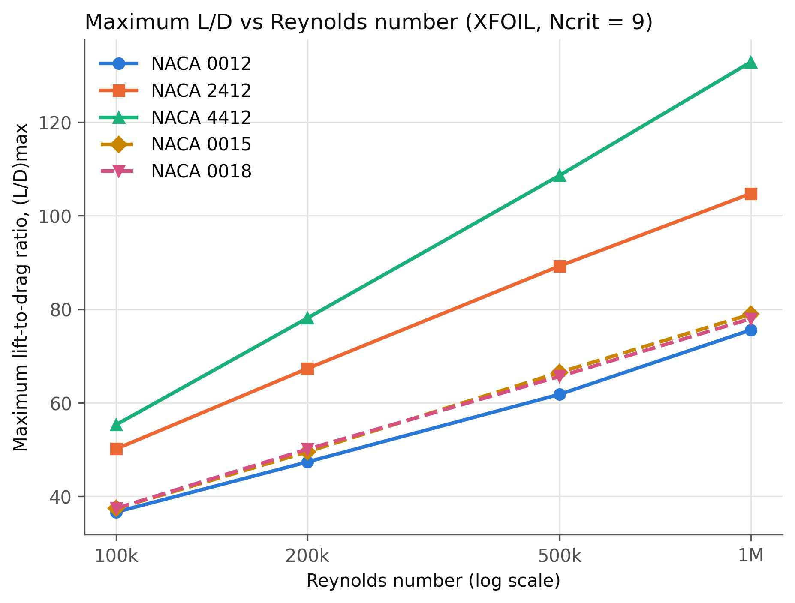

# The Effects of Airfoil Geometry on Lift-to-Drag Performance

An independent aerodynamics study by **Aarnav Ravi** (2026).

[](https://doi.org/10.5281/zenodo.23895385)

This project uses [XFOIL](https://web.mit.edu/drela/Public/web/xfoil/) to test how **camber** and **thickness** affect the maximum lift-to-drag ratio, (L/D)max, of five NACA 4-digit airfoils at Reynolds numbers from 100,000 to 1,000,000. Results were checked against wind-tunnel data from NACA Report 824.

The full report is in [`paper/airfoil_LD_report.pdf`](paper/airfoil_LD_report.pdf).

## Key results

| Airfoil | (L/D)max at Re = 100k | (L/D)max at Re = 1M |
|---|---|---|
| NACA 0012 | 36.7 | 75.6 |
| NACA 2412 | 50.2 | 104.7 |
| NACA 4412 | 55.4 | 132.9 |
| NACA 0015 | 37.4 | 78.9 |
| NACA 0018 | 37.5 | 78.0 |

- **Camber** had the largest effect: (L/D)max rose about 76% from the NACA 0012 to the NACA 4412 at Re = 1M.
- **Thickness** (12% to 18%) changed (L/D)max by less than 8%, and did not reduce it as hypothesized.
- **Reynolds number:** (L/D)max increased for every airfoil, with the biggest gains between 100k and 500k.
- **Validation:** for the NACA 2412 at Re = 3.1M, XFOIL over-predicted maximum lift by about 11% and under-predicted minimum drag by about 16% compared with NACA Report 824.



## Repository contents

```
paper/                 the full report (PDF)
run_sweeps.py          runs every XFOIL sweep and builds the dataset
plot_results.py        makes Figures 1-4
data/raw/              raw XFOIL polar files, one per airfoil and Reynolds number
data/all_polars.csv    every converged point, with L/D
data/summary.csv       (L/D)max and its angle of attack for each run
data/validation_*      NACA 2412 validation run at Re = 3.1M
data/run_log.txt       settings used and points that failed to converge
figures/               Figures 1-4 (300 dpi PNG)
```

## Reproducing the results (macOS, Apple Silicon)

1. Install the software:
   ```
   brew install --cask xquartz
   brew tap chrislupp/xfoil
   brew trust chrislupp/xfoil
   brew install xfoil
   python3 -m pip install --user matplotlib
   ```
2. Run the simulations and make the figures:
   ```
   python3 run_sweeps.py
   python3 run_sweeps.py --validation-only
   python3 plot_results.py
   ```

Settings: XFOIL 6.99, Mach 0, Ncrit = 9, 160 panels, 100 iterations, angle of attack from -5° to 15° in 0.5° steps (-5° to 20° for validation).


## How to cite

See [`CITATION.cff`](CITATION.cff), or use the "Cite this repository" button on GitHub.

## License

- Code (`*.py`): MIT License (see [`LICENSE`](LICENSE))
- Data, figures, and report: [CC BY 4.0](https://creativecommons.org/licenses/by/4.0/)
